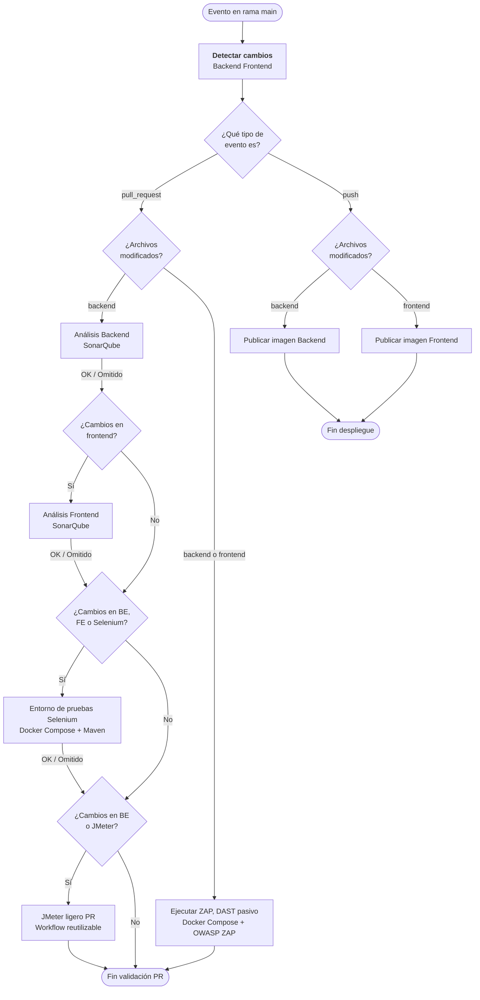

# Pipeline de Integración Continua (CI) - CuidartePlus

Este flujo de trabajo automatiza el control de calidad, pruebas funcionales, análisis de seguridad, rendimiento y publicación de contenedores para el proyecto **CuidartePlus**.

## Disparadores (Triggers)
El pipeline se ejecuta únicamente sobre la rama `main` bajo dos eventos:
* **`pull_request`**: Ejecuta toda la batería de validaciones antes de permitir la fusión del código.
* **`push`**: Construye y publica las imágenes Docker actualizadas en el registro correspondiente.

## Arquitectura y Flujo de Ejecución

El pipeline utiliza `dorny/paths-filter` para detectar qué partes del repositorio cambiaron y omitir tareas innecesarias, optimizando tiempos de ejecución.

## Detalle de los Jobs

| Job | Evento | Condición de activación | Descripción |
| :--- | :--- | :--- | :--- |
| **Detectar cambios** | `push` / `pull_request` | Siempre | Analiza los archivos modificados (`BACKEND/`, `FRONTEND/`, `pruebas-selenium/`, `pruebas-jmeter/`, `docker-compose.yml` o el propio workflow). |
| **Análisis Backend** | `pull_request` | Cambios en `backend` | Ejecuta escaneo estático con SonarQube en `./BACKEND/src` y bloquea el flujo si el *Quality Gate* no es `OK`. |
| **Análisis Frontend** | `pull_request` | Cambios en `frontend` + Backend OK/Omitido | Ejecuta escaneo estático con SonarQube en `./FRONTEND/src` y valida el *Quality Gate*. |
| **Entorno de pruebas Selenium** | `pull_request` | Cambios en `backend`, `frontend` o `selenium` | Levanta el entorno completo con Docker Compose (PostgreSQL, Backend, Frontend) y ejecuta pruebas E2E con JDK 21 y Maven. |
| **Ejecutar ZAP, DAST pasivo** | `pull_request` | Cambios en `backend` o `frontend` | Corre en paralelo. Levanta el stack y realiza un escaneo pasivo de vulnerabilidades web contra `http://localhost:3333`. |
| **JMeter ligero (PR)** | `pull_request` | Cambios en `backend` o `jmeter` | Invoca el workflow reutilizable `jmeter-pr.yml` para pruebas básicas de carga tras pasar Selenium. |
| **Publicar imágenes (BE/FE)** | `push` | Cambios en `backend` o `frontend` | Construye y sube las imágenes de producción de los servicios modificados. |

## Artefactos y Reportes Generados

Al finalizar la ejecución, el pipeline adjunta los siguientes reportes en la pestaña **Actions** de GitHub:
* **`sonar-analysis-results`**: Reportes de calidad de código en formato Markdown (`analysis_report.md`).
* **`Selenium Results`**: Resultados de pruebas JUnit publicados directamente en el resumen del *Pull Request* (incluye logs de depuración si ocurre un fallo).
* **`zap-baseline-html`**: Informe detallado en HTML con las alertas de seguridad detectadas por OWASP ZAP.

## Requisitos y Variables de Entorno

Para la ejecución de pruebas integradas (Selenium y ZAP), el workflow levanta contenedores temporales con la siguiente configuración interna:
* **Base de datos:** PostgreSQL (`cuidarteplus_test`) en el puerto `15442`.
* **API Backend:** Puerto `4444` (verificado mediante `/openapi.json`).
* **Aplicación Frontend:** Puerto `3333`.
